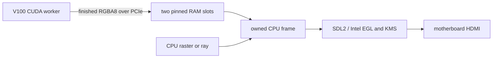

# Real-time rendering preview

`eclair-rt` renders a Cornell-style room or a material scene using CPU
rasterization, CPU ray tracing or CUDA software ray tracing on a V100.
The presenter and the CUDA worker are separate processes.

## Build and run

On Linux, the default build includes a headless presenter. Enable
`ECLAIR_BUILD_RENDER_DEMO` to build the SDL2 presenter instead. The
headless mode can write a frame to a new PPM file:

```sh
cmake -S . -B build -DCMAKE_BUILD_TYPE=Release
cmake --build build --target eclair-rt
build/eclair-rt --headless --mode cpu-ray --scene materials \
  --width 640 --height 360 --frames 1 --output preview.ppm
```

Build with `ECLAIR_ENABLE_CUDA=ON` and `ECLAIR_CUDA_ARCHITECTURES=70` to
run the CUDA worker. Use `--mode cuda-ray` and, for a separately built
worker, set `--cuda-worker` to its absolute path. The
[V100 build guide](DEBIAN_V100.md) covers the CUDA toolchain.

In the SDL presenter, **1** selects CPU raster, **2** CPU ray and **3** CUDA
ray. **S** freezes animation while sampling continues. **A** resumes animation,
**Space** pauses rendering and **Esc** quits. Use `--scene cornell` for the
baseline or `--scene materials` for metal and glass. The same controls are
available through `eclair-rt --control` on the local control socket.

## Ownership, memory and PCIe



The worker registers only its bounded shared frame allocation with
`cudaHostRegister`, allocates its own VRAM, and uses supported CUDA streams,
events and `cudaMemcpyAsync`. An event must complete before it acknowledges a
frame. The presenter validates slot/sequence ownership before reading, copies
into its own frame, and then permits reuse. A completed frame is prefetched
before Intel waits for vblank; there is at most one outstanding CUDA request.
There is no unbounded queue and no simultaneous overwrite of a CPU-owned
slot. The worker's shared memfd cannot grow or shrink after creation.

Filtering and tone mapping finish in VRAM. Only RGBA8 crosses PCIe; at 1080p60
the image payload is 0.498 GB/s. Two pinned slots use 16,588,800 bytes and the
presenter's CPU frame uses 8,294,400 bytes. Raw rendering uses one 8,294,400-byte
VRAM target. Filtering additionally uses two history/geometry records and two
FP32 RGB scratch images per pixel, totaling 273,715,200 explicit VRAM bytes
at 1080p before the lighting atlas. The materials scene adds twenty 64x64
tiles: 81,920 texels, with two 28-byte histories and two RGB scratch arrays,
6,553,600 bytes. The total is **280,268,800 explicit VRAM bytes**. The status
report includes these allocations.
CUDA context, driver, allocator and Intel display memory are
additional. Intel shares system RAM and retains scanout buffers in every mode.

Switching to CPU or pause stops/reaps the worker, unregisters pinned pages,
unmaps its shared frames and releases its VRAM/context. Pause also releases
the CPU frame; stop closes the presenter and its textures. The tty still
needs an Intel framebuffer. Release concerns this demo's allocations, not
other applications' CUDA contexts. No global GPU reset is used. This is
scoped CUDA buffer access, not a global switch granting arbitrary RAM DMA.
`ECLAIR_DISABLE=rt.emulation` prevents worker context creation entirely.

Sending pixels directly into CPU registers is not a display path: the CPU
also reads RAM and a display adapter scans out a framebuffer. PRIME render
offload similarly separates the rendering GPU from the display GPU, using
supported graphics buffer sharing and synchronization. It does not establish
CUDA-to-Intel zero-copy support here. The measured PCIe path is sufficient;
no custom PCIe protocol or undocumented driver behavior is needed.

## Numerical and preview contracts

`ops/ray_trace.hpp` bounds dimensions to 4096x4096, primitives to 16,
samples to 1..8 and scattering vertices to 1..8. Inputs must be finite,
camera axes orthonormal, and output extents sufficient. Host and CUDA share
FP32 analytic sphere/rotated-box/quad intersections and shading. CUDA callers
own allocations and streams; launch wrappers neither allocate nor synchronize.
This is an experimental C++ contract with one documented demo consumer.

Material, geometry and shading are separate reusable layers:

| Header | Contract |
| --- | --- |
| `render/vector.hpp` | Shared FP32 vector math |
| `render/material.hpp` | Linear RGB material values and validation |
| `render/bsdf.hpp` | Lambert diffuse; single-scattering GGX conductor evaluation and visible-normal sampling; smooth dielectric Fresnel/refraction |
| `render/geometry.hpp` | Analytic intersections, oriented normal and entering/exiting flag |
| `render/shading.hpp` | Path integration, light visibility, MIS and display transform |
| `render/surface_lighting.hpp` | Object-space diffuse lighting atlas, direct quadrature and indirect history |
| `render/preview_shading.hpp` | Cached diffuse lookup, split Fresnel branches and sampled GGX preview |
| `render/denoise.hpp` | Preview reconstruction and scene/camera identity for pixel history |

`Material::base_color` is diffuse reflectance, conductor normal-incidence
reflectance, or dielectric transmission tint **per interface**, respectively.
Conductor roughness is perceptual: GGX alpha = max(0.001, roughness squared);
exact zero selects a delta mirror. Diffuse is Lambertian; its roughness field
does not alter the lobe. Glass requires roughness zero and IOR 1..3. Spheres
and boxes are closed solids; sheets and conservatively overlapping glass
bounds are rejected. The surrounding medium is air; nested media, absorption
by distance, rough transmission and dispersion are not implemented.

The unfiltered tracer combines rectangular area-light sampling with BSDF
sampling using the power heuristic. Narrow conductor lobes (roughness below
0.25) use BSDF sampling alone, with the corresponding emitter MIS weight
removed. The final scattering vertex still samples the light because no
further BSDF ray will run. Independent area quadrature tests both policies. Glass chooses reflection/transmission
with exact unpolarized Fresnel probabilities, handles total internal
reflection, offsets rays to the correct side of the interface, and applies
the radiance eta-squared factor. A constant scene environment supplies miss
radiance. Shadow visibility treats glass as a blocker; there is no dedicated
refracted-shadow or focused-caustic estimator. Rare BSDF paths can still
produce noisy caustic contributions. Extra emissive primitives are sampled
through BSDF paths; the explicit area-light geometry should match its emitter.

Multisampling covers pixel area with stratified X and rotated base-two Y.
FP32 intermediates remain linear until the published ACES fitted curve and
IEC sRGB transfer encode RGBA8. This replaces the previous square-root
Reinhard transform, so previous RGB8 captures are not color-equivalent.
No monitor brightness, gamma, DDC/CI or HDR setting is written. The CUDA
translation unit keeps `--fmad=false`; RNG updates are explicitly sequenced
for host/device reproducibility.

The optional preview is separate from the unfiltered oracle. The demo now
supplies a caller-owned object-space lighting atlas. Every nonemissive diffuse
quad has two 64x64 tiles, spheres have two latitude/longitude tiles, and boxes
have twelve face/side tiles. Coordinates are independent of the camera and
preserve primitive/face identity. Bilinear lookup supplies diffuse outgoing
radiance both to direct camera rays and to reflected/refracted rays, including
surfaces outside the screen. This amortizes lighting work rather than tracing
fresh noisy diffuse paths independently in every reflection.

Direct diffuse lighting uses a fixed 4x4 area-light quadrature with traced
shadow visibility. Eight cosine-weighted paths per texel estimate the remaining
indirect light; a direct BSDF hit on the explicitly sampled emitter is excluded
to avoid counting it twice. Only indirect lighting gets the five-tap X/Y atlas
filter and temporal averaging: up to 32 frames during scene motion, or 1024
when the entire scene is stationary (camera changes alone do not invalidate
object-space history). Direct lighting updates immediately, avoiding stale
primary shadows. This approximates soft shadows at atlas resolution, and
indirect light can lag changing occlusion. Spherical tile borders clamp rather
than wrap, so polar/seam neighborhoods have a bounded reconstruction seam.

The cached specular integrator evaluates both exact Fresnel branches, with
Snell refraction, total internal reflection, interface tint and eta-squared
radiance scaling. An eight-entry local stack bounds branching to the validated
eight-vertex limit. GGX uses stratified samples with per-pixel rotations in
both dimensions, varying across frames. Broad conductors (roughness >= 0.25)
use fixed 2x2 direct-light quadrature and exclude the corresponding BSDF emitter
hit. Emitter paths through any rough reflection followed by further
specular interfaces are omitted in this preview to suppress unresolved bright
caustic sparks. The raw integrator retains these contributions. The cache also
reuses lighting computed with its own bounce budget, so this is not the same
path-length integral as raw tracing at an equal vertex count.

Primary position/normal/primitive guides keep filtering within a surface.
Eight separable five-tap passes at strides 1,2,4,8 smooth diffuse lighting and
cached conductors with roughness >= 0.3. Cached glossy conductors with roughness
0.08..0.3 use only strides 1/2. Smoother conductors and delta mirrors do not
enter spatial blur. Glass uses only a one-pixel horizontal/vertical luminance
median, preserving color steps while rejecting isolated secondary-lobe sparks;
it may remove a one-pixel highlight. These filters soften rough reflections.

Pixel radiance history requires identity of the entire scene and camera for
specular surfaces. Stationary diffuse pixels now use the same unclipped
1024-frame accumulation; the old 32-frame neighborhood clipping prevented
proper stationary convergence. Camera/rigid-box reprojection with clipped
32-frame history remains available in the legacy preview without an atlas.
Cached diffuse pixels use atlas history directly, avoiding duplicate temporal
lag. Reset both histories on mode changes, camera cuts, topology, light or
material changes. No history is reprojected using only a reflected surface.

A compacted boundary list resolves sixteen deterministic subpixel primary rays
after filtering. With the atlas, specular coverage uses the cached integrator. Diffuse coverage
uses nearby matching denoised guides, falling back to atlas lookup for a thin
surface without a matching guide. Without an atlas it keeps the legacy
matching-guide reconstruction. Coverage affects only display RGBA and never enters
surface history. Atlas lighting and pixel/specular history remain in VRAM.
No raw stochastic path bypasses the cached preview at boundaries.

All of these are bounded, biased real-time reconstruction choices. They do not
establish unbiased convergence, native-4K detail or production denoiser quality.
Sharp moving highlights can retain faint noise and aliasing. Raw CPU/CUDA
tracing remains available as the numerical reference.

The preceding implementation traced sixteen random full paths at boundaries
and excluded those pixels from spatial denoising. It produced a visible noisy
strip at the ceiling/wall seam. Increasing coverage samples alone did not fix
that estimator mismatch. Coverage now stays deterministic across random seeds
while its diffuse lighting benefits from the same denoising as the room.

Boundary classification reserves queue space once per nonempty warp. A dense
kernel consumes the list, avoiding mostly idle warps along long room edges.
The queue reuses scratch VRAM after filtering, with all phases ordered in one
CUDA stream; no extra allocation or CPU count readback is needed.

The raster baseline shares geometry, camera and material colors but uses
simple local lighting and tessellated spheres, without traced shadows,
reflections, refraction or indirect illumination.
CPU/CUDA raw tracing comparisons measure the same algorithm. Raster versus
CUDA tracing changes both processor and algorithm, so its timing is not a
like-for-like GPU speedup claim.

## Reusing the renderer in another application

An application can construct its own `ops::RayScene`, `RayCamera` and
`RayTraceShape`; the library has no dependency on Cornell geometry, SDL or
service control. Check `validate_ray_trace`, then use
`host::ray_trace_reference` or `cuda::launch_ray_trace` with a caller-owned
RGBA8 buffer. CUDA callers select a supported capability, honor feature
policy, own their allocations/stream, and wait for stream completion before
reading or freeing output. Filtering is a separate optional operation with
caller-owned history and scratch. CMake targets are `eclair_backend_host`,
`eclair_ops` and optionally `eclair_cuda`. These C++ interfaces are experimental.

The demo's protocol-v2 scene IDs select built-in scenes and are not a general
scene-submission API. Version mismatches fail before frame exchange; deploy
presenter and worker together. The reusable layer is the library operation,
not that demo-specific socket protocol.

Launching an arbitrary game or graphics application through Eclair would
also need a graphics API frontend, shader/material/resource translation,
triangle/mesh geometry and a measured acceleration structure, synchronization
contracts and conformance tests. None of DXR, Vulkan RT, shader interception,
mesh import or a general game launcher is implemented here. A second small
consumer that submits its own scene is a useful next contract gate before
building such an adapter. The NVIDIA driver boundary remains intact.

## Algorithm provenance

The material code is independently implemented from public equations:
Lambert reflection, GGX/Trowbridge-Reitz microfacets, Smith masking, Schlick
conductor Fresnel, exact unpolarized dielectric Fresnel, and Snell refraction.
Visible-normal sampling follows the algorithm in Eric Heitz,
[Sampling the GGX Distribution of Visible Normals, JCGT 7(4), 2018](https://jcgt.org/published/0007/04/01/).
The display curve uses the published coefficients from
[the Narkowicz ACES fit](https://knarkowicz.wordpress.com/2016/01/06/aces-filmic-tone-mapping-curve/)
followed by the standard sRGB transfer; it is not a complete ACES color pipeline.
No upstream implementation, model, texture or scene asset was copied and no
runtime dependency/download was added. Eclair source remains AGPL-3.0-or-later.
